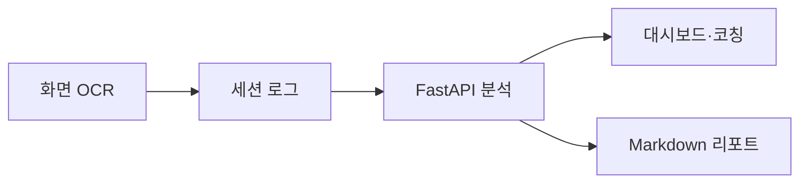

[← 포트폴리오](../README.md)

# ScreenCoach

화면을 OCR로 읽고 현재 작업과 반복 패턴을 정리하는 Windows 코칭 프로토타입입니다. 해커톤 참여 프로젝트에서 화면 수집·분석·대시보드·리포트 흐름을 구현했습니다.

- Windows OCR로 화면 텍스트와 영역을 수집
- 세션 타임라인과 반복 신호를 분석해 다음 작업 제안
- 현재 화면을 바탕으로 질문하고 Markdown 리포트 내보내기
- AI 연결이 없을 때 규칙 기반 코칭 경로 제공

**Python · FastAPI · Windows OCR · HTML/CSS/JavaScript**

상용 서비스 출시 이력이 아닌 해커톤·프로토타입 개발 경험입니다.
